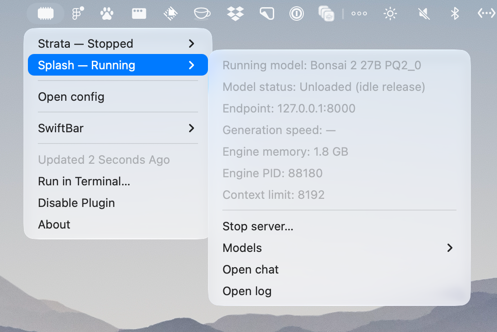

# Local LLM Server

Monitor Strata and Splash, select models, and start or stop servers from one SwiftBar menu. You can operate the two engines independently.



## Setup

You need macOS, [SwiftBar](https://github.com/swiftbar/SwiftBar), `uv`, and Python 3.12 or later. Install Strata and Splash separately. Check each engine's distribution for supported hardware, OS versions, and model requirements.

```fish
brew install uv
uv python install 3.12
```

Run the following command from `plugins/local-llm-server/`, the directory containing this README:

```fish
cp -n config/local-llm-server.example.json config/local-llm-server.json
```

`cp -n` preserves any existing configuration. The example has empty model lists, so register the models you want to use in your local configuration. You can use either engine on its own.

Set SwiftBar's plugin folder to `enabled/` at the repository root, following the [shared setup instructions](../../README.md#setup). `enabled/local-llm-server.5s.sh` is a relative symlink to this directory's entry script. The script resolves its location through the symlink target and does not depend on the working directory.

Do not use installation paths containing newlines, control characters, or `|`. Periodic refreshes do not download Python or models.

## Registering models

Edit `config/local-llm-server.json` in this directory. Git ignores this local configuration file. You can also open it with `Open config` at the bottom of the menu.

Models added to the JSON appear under `Models` on the next refresh. Editing the file does not download models, start servers, or change a running server's configuration.

### Strata

Prepare models through Strata's setup first, then register each model's configuration JSON. The plugin does not synchronize with Strata Menubar settings.

| Field | Description |
|---|---|
| `strata.directory` | Strata installation directory; must contain `.venv/bin/python` and `serve/server.py` |
| `strata.port` | Server port; defaults to 8080 |
| `strata.models[].id` | Unique ID within this engine |
| `strata.models[].name` | Display name in the menu |
| `strata.models[].config` | Path to a prepared Strata configuration JSON |

Manage expert cache and context limits in the referenced Strata configuration JSON. The plugin does not rewrite that file. Strata's own web settings and other operations may write to the source file or adjacent files.

### Splash

Register a Hugging Face model ID. For GGUF models, use `OWNER/REPO:VARIANT` as required by Splash.

| Field | Description |
|---|---|
| `splash.executable` | Optional; when omitted, searches PATH and standard Homebrew locations for `splash` |
| `splash.port` | Server port; defaults to 8000 |
| `splash.modelCacheDir` | Optional model storage directory, passed to the child process as `HF_HUB_CACHE` |
| `splash.models[].id` | Unique ID within this engine |
| `splash.models[].name` | Display name in the menu |
| `splash.models[].model` | Hugging Face model ID passed to Splash |
| `splash.models[].args` | Per-model CLI argument array; defaults to an empty array |

When you choose `Start server` or switch models while running, Splash downloads missing models, drafts, and other required files before starting. It may check online even for cached models. Check your network connection and free disk space before starting, as downloads can be large. SwiftBar continues refreshing during downloads; use `Open log` for progress and failure details.

Omit `modelCacheDir` to keep the existing storage location. Setting it does not move previously downloaded files.

In `args`, put each argument and value in a separate string. The plugin does not perform shell expansion. For example, use `["--max-context", "8K"]` to limit context. An empty array leaves memory, context, image support, ANE, and SSD caching to Splash's defaults. Check `splash serve --help` for the options supported by your installed version.

You cannot set `--model`, `--host`, `--port`, `--offline`, control options such as help, or their abbreviations in `args`. At launch, the plugin removes `HF_HUB_OFFLINE` and `TRANSFORMERS_OFFLINE` from the child process environment. It does not change the parent environment.

### Shared constraints

- Registration IDs (`models[].id`) must contain at most 64 letters, digits, hyphens, or underscores and start with a letter or digit. These differ from Hugging Face model IDs. Keep the ID when changing only a display name, since the plugin uses it to track selection.
- Use absolute paths or `~/` for file paths. Model IDs and CLI arguments are not file paths.
- Servers bind to `127.0.0.1`. You cannot assign the same port to both engines.
- You can launch servers that require authentication, but the plugin cannot read monitoring APIs that require authentication. It does not manage API keys.

## Menu actions

Fixed UI text is in English. Model display names use the JSON `name` value without translation.

| Action | Behavior |
|---|---|
| Strata → Models → model → Select model | Select a Strata model |
| Strata → Models → model → Open model config | Open that model's Strata configuration JSON without selecting it or restarting |
| Splash → Models → model | Select a Splash model |
| Start server | Start the selected model |
| Stop server… | Stop after confirmation, interrupting any active requests |
| Open chat | Open chat in the browser; disabled while stopped |
| Open log | Open the server log |
| Open config | Open the plugin's local configuration JSON |

Selecting a model while stopped only saves the selection. Changing models while running stops and restarts the server after confirmation. Canceling leaves both selection and server unchanged. If shutdown fails, the plugin does not start the next server.

The plugin allows Strata and Splash to run at the same time. Check available memory before starting them.

Servers started elsewhere are monitoring-only: the plugin cannot stop them, take ownership, or change their models. To move from Strata Menubar, stop the server there and quit the app, then start through SwiftBar once the port is free.

Managed servers keep running when you quit SwiftBar or remove the plugin symlink. Use `Stop server…` first if you want to stop a server. After restarting SwiftBar, you can resume control. The plugin does not start servers at login or restart them after a crash.

## Status display

The menu refreshes every five seconds. Top-level entries show statuses such as `Strata — Stopped` and `Splash — Running`. Each submenu contains model, endpoint, generation speed, memory, and context details, with a separator between status and actions.

| Icon | State |
|---|---|
| `memorychip` | All servers stopped; stays off during startup |
| `memorychip.fill` | At least one server running; stays on during shutdown |
| `exclamationmark.circle.fill` | Error; takes precedence over other states |

- **Generation speed**: Strata uses the API's moving window. Splash uses the recent increase in output tokens divided by elapsed time. The menu shows `—` without a valid observation, including when idle, on the first sample, after restart, or after sleep.
- **Engine memory**: Physical footprint of the native inference engine alone, in decimal GB. The plugin excludes API server memory and shows `—` when measurement is unavailable. It uses the same metric as Activity Monitor, but comparison against real engines is not yet complete.
- **Model status: Unloaded (idle release)**: The server is running but has released the model weights. It reloads them on the next request. `Open chat` remains available.
- **Monitoring: Unavailable**: Monitoring is unavailable. This does not mean the server has stopped.

## Configuration, logs, and state

| Data | Location |
|---|---|
| Local configuration | This plugin's `config/local-llm-server.json` |
| Server logs | `~/Library/Logs/swiftbar-plugins/llm/` |
| Selection, ownership, and observations | `~/Library/Application Support/swiftbar-plugins/llm/` |
| Model files | Strata's existing locations or Splash's model cache |

State and logs live outside the repository. Logs rotate at 1 MiB per file with up to two backups. For Strata engine logs, also check the `log` field in the registered JSON.

Stop and log access remain available for a managed server even if the configuration breaks or you remove its model registration. If you see `Ownership unknown`, check the launch logs or Activity Monitor. The plugin does not stop processes using stale PIDs or take ownership of external servers automatically. Do not delete state files while a server remains running.

If startup reports `Address already in use`, check the configured port and logs. The plugin does not stop other apps or switch to another port automatically.

## Development

See [AGENTS.md](AGENTS.md) for change, validation, and safety guidelines. The [implementation plan](docs/plans/2026-10-19-llm-menu.md) records the design and initial setup history.
